<div align="center">



<br/>


</div>

Diseño de una **malla de perforación y tronadura para explotación a rajo abierto** con Python. A partir de las propiedades de la roca y del explosivo calcula el burden, el espaciamiento y el taco crítico, genera las coordenadas de cada pozo y dibuja la malla en 3D con la distribución de carga de cada pozo.

> Desarrollado en el curso *Diseño de malla de producción de rajo abierto* de [Nube Minera](https://nubeminera.cl/curso/dmp/).

<div align="center">

<br/><sub>Malla en 3D: cada pozo dividido en pasadura, carga explosiva y taco</sub>
</div>

## 📐 Métodos

- **Pearse-Borquez** para el burden, a partir del índice de volabilidad (Kv), el RQD equivalente, la potencia de detonación y la resistencia a la tracción de la roca.
- **Taco crítico de Chiappetta**, a partir de la profundidad de entierro escalada y la masa explosiva por metro.

Las fórmulas están escritas en el propio notebook.

## 🔢 Caso de ejemplo

| Entrada | Valor | | Resultado | Valor |
|---|---|---|---|---|
| Diámetro del pozo | 12" (0,30 m) | | **Burden** | 7 m |
| Altura de banco | 12 m | | **Espaciamiento** | 7 m |
| Densidad de roca | 2,7 t/m³ | | **Taco** | 5 m |
| Densidad del explosivo | 1,1 t/m³ | | **Pasadura** | 1,4 m |
| VOD | 3.947 m/s | | **Carga explosiva** | 8,4 m |
| RQD | 60 % | | **N° de pozos** | 60 |
| UCS | 1.529,58 psi | | **Metros perforados** | 804 m |
| Malla | 80 × 30 m | | | |

## 🚀 Cómo ejecutarlo

1. Instala las dependencias: `pip install numpy pandas plotly`.
2. Abre `DISEÑO MALLA DE PRODUCCIÓN - PERFORACIÓN.ipynb` y ajusta los antecedentes de la primera celda (diámetro, explosivo, roca y dimensiones de la malla).
3. Ejecuta las celdas para obtener la tabla de resultados y la malla 3D interactiva.

```
├── DISEÑO MALLA DE PRODUCCIÓN - PERFORACIÓN.ipynb   ← cálculo y gráfico
├── imagen malla.png                                 ← malla de ejemplo
└── assets/                                          ← banner de este README
```

---

<div align="center">

Hecho por **[Marcelo Reinoso](https://github.com/Monokhan)** · datos aplicados a minería e infraestructura

</div>
